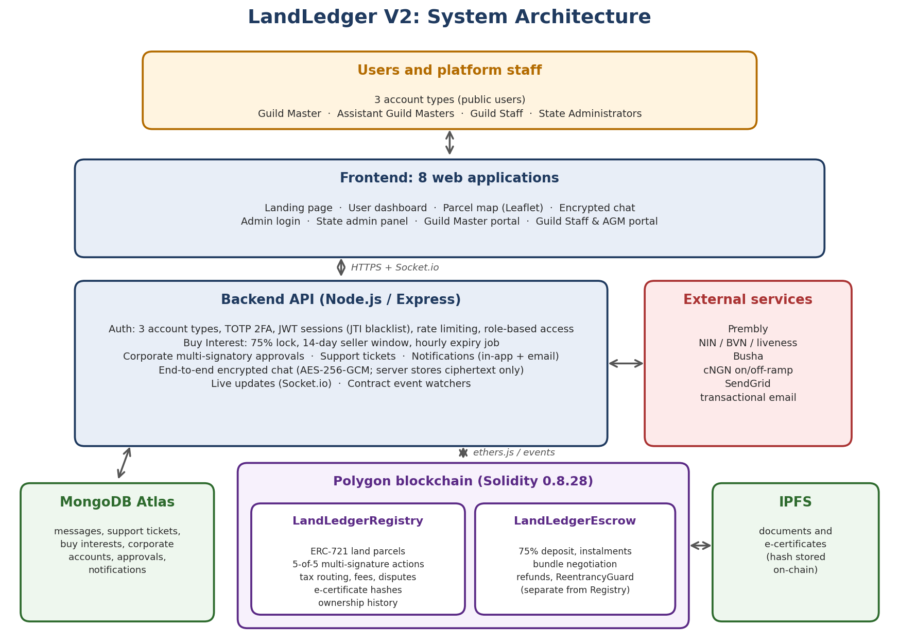
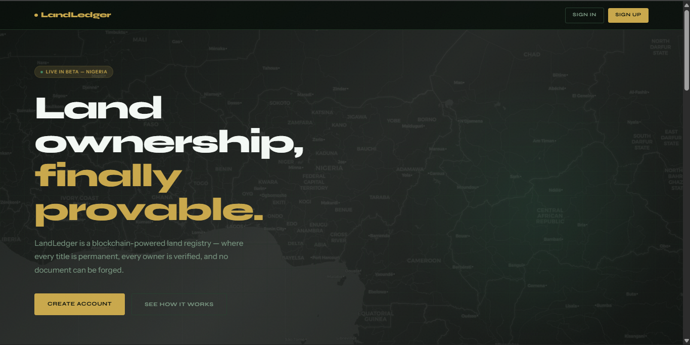
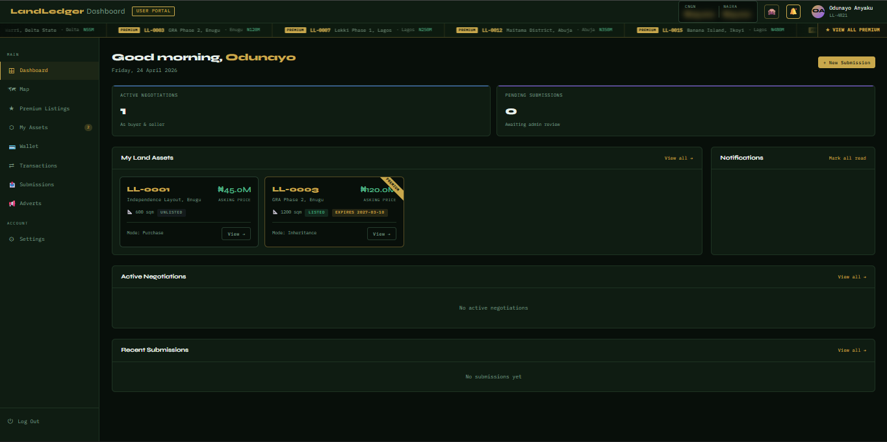

# LandLedger

**A blockchain-based land title registry built to make land records in Nigeria permanent, verifiable and resistant to fraud.**

Designed and built end to end by one developer: two Solidity smart contracts, a Node.js/Express backend, and eight web applications.

---

## Project status

LandLedger V2 is **complete and deployment-ready, but pre-launch**.

- The smart contracts have **not yet been deployed to mainnet**, and an independent smart contract audit is planned before launch.
- The identity verification, payment and email integrations are written and need production credentials to go live.
- This repository contains the project overview only. The full source code is private and available for review on request.

---

## The problem

Land ownership records can be forged, sold twice, disputed or lost. Approvals and tax payments happen in separate steps, and a paper or database record can be altered after the fact. Buyers, sellers and government offices all carry the risk.

## The solution

LandLedger records every land parcel as a token on a public blockchain, and ties each parcel to its documents, approvals, taxes and payment in one verifiable process.

- **Ownership is a permanent record.** Each parcel is an ERC-721 token with a full ownership history from registration to today.
- **Documents cannot be quietly altered.** A cryptographic hash of each document is stored on-chain, so any change to the document stops matching the record.
- **Sellers are paid only when the title transfers.** This is enforced by the escrow contract code, not by a company promise.
- **Every sensitive action leaves a trail.** Administrator actions, whether or not they are executed, are recorded on-chain with the authorising wallet address and a timestamp.
- **Taxes are collected in the same transaction.** Stamp Duty is routed automatically in the same atomic transaction as the title transfer.

---

## Key features

### Smart contracts (Solidity 0.8.28, Hardhat)
**LandLedgerRegistry**
- ERC-721 land parcel tokens with full ownership history
- Five-of-five unanimous multi-signature approval for every sensitive action
- Automatic federal and state tax routing at the point of transfer
- Configurable listing fees and document access fees
- On-chain dispute tracking
- E-certificate storage by IPFS hash and Governor's Consent workflow recording

**LandLedgerEscrow** (deliberately separate from the Registry to reduce the attack surface on ownership records)
- 75% deposit mechanic, with lump-sum or instalment payment plans
- Bundle negotiation for multi-parcel deals (single total or per-parcel pricing)
- Automatic cancellation and full-refund logic
- OpenZeppelin ReentrancyGuard on all fund-moving functions

### Backend (Node.js / Express)
- Three account types, with TOTP two-factor authentication
- JWT sessions with JTI blacklisting and session versioning; rate-limited login
- Role-based administration: Guild Master, Assistant Guild Masters, Guild Staff and State Administrators
- Identity verification through Prembly (NIN, BVN, liveness)
- cNGN on-ramp and off-ramp through Busha, with HMAC-SHA256 webhook verification
- Buy Interest system: a buyer can register interest in an unlisted parcel by locking 75% of the assessed value, with a 14-day seller response window, automatic warnings and automatic expiry
- Corporate accounts with multi-signatory purchase approval
- Support tickets routed to the relevant state administrators
- Real-time notifications (Socket.io), each also sent by email (SendGrid)
- End-to-end encrypted chat: keys are derived from user passwords with PBKDF2 (310,000 iterations), and the server stores ciphertext only

### Frontend (8 web applications)
Landing page and registration, user dashboard, Leaflet parcel map with negotiation and bundle selection, encrypted chat, admin login, state admin panel, Guild Master portal, and Guild Staff and AGM portal.

---

## Architecture

[View the architecture diagram full size](docs/architecture.png)

---

## Screenshots

### Landing page

[View landing page full size](screenshots/landing-page.png)

### User dashboard

[View dashboard full size](screenshots/dashboard.png)

---

## Tech stack

| Layer | Technology |
|---|---|
| Smart contracts | Solidity 0.8.28, OpenZeppelin, Hardhat 3 |
| Blockchain network | Polygon (Amoy testnet and Mainnet configured) |
| Backend | Node.js, Express, Socket.io, Mongoose |
| Database | MongoDB Atlas |
| Frontend | HTML, CSS, JavaScript, Leaflet |
| Integrations | Prembly (identity), Busha (cNGN), SendGrid (email) |
| Storage | IPFS (documents and e-certificates) |

---

## Security design

- Reentrancy protection on all fund-moving escrow functions
- Payments and ownership kept in separate contracts
- Unanimous multi-signature governance, which limits the risk of a single compromised or colluding administrator
- Tamper detection through on-chain document hashes
- Two-factor authentication, session blacklisting and rate limiting
- Independent smart contract audit planned before mainnet deployment

---

## Source code

The full source code is private. A walkthrough or code review is available on request.

## Author

**Odu, Stephen Anyaku**: founder and developer, LandLedger Registries Services
[LinkedIn](https://linkedin.com/in/anyaku3) · [Medium](https://medium.com/@anyaku3/)
